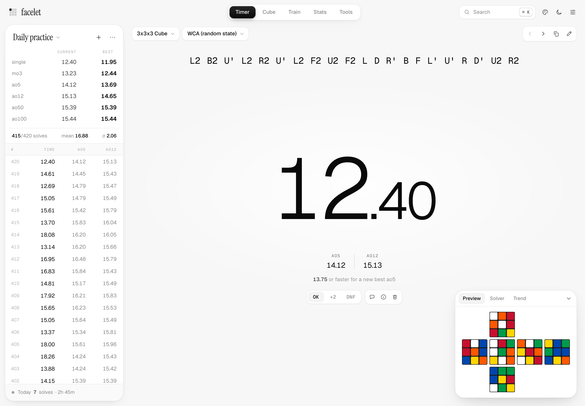
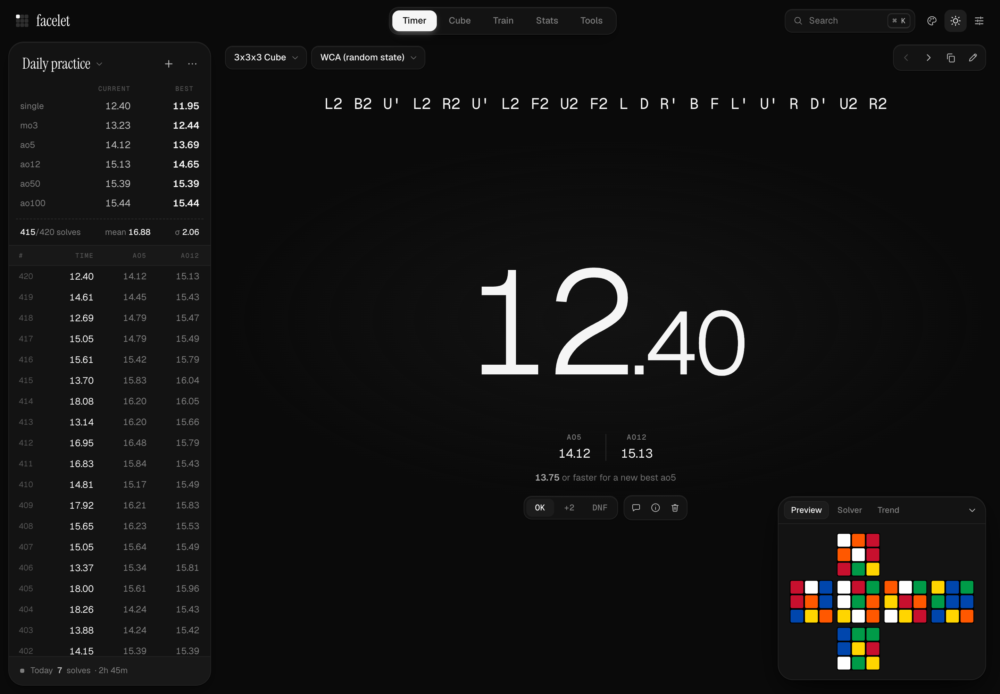
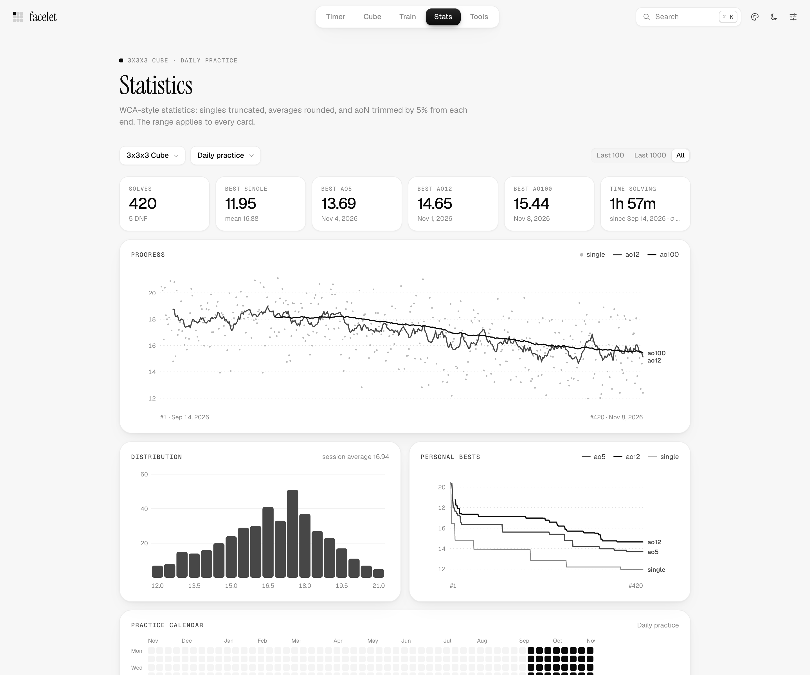
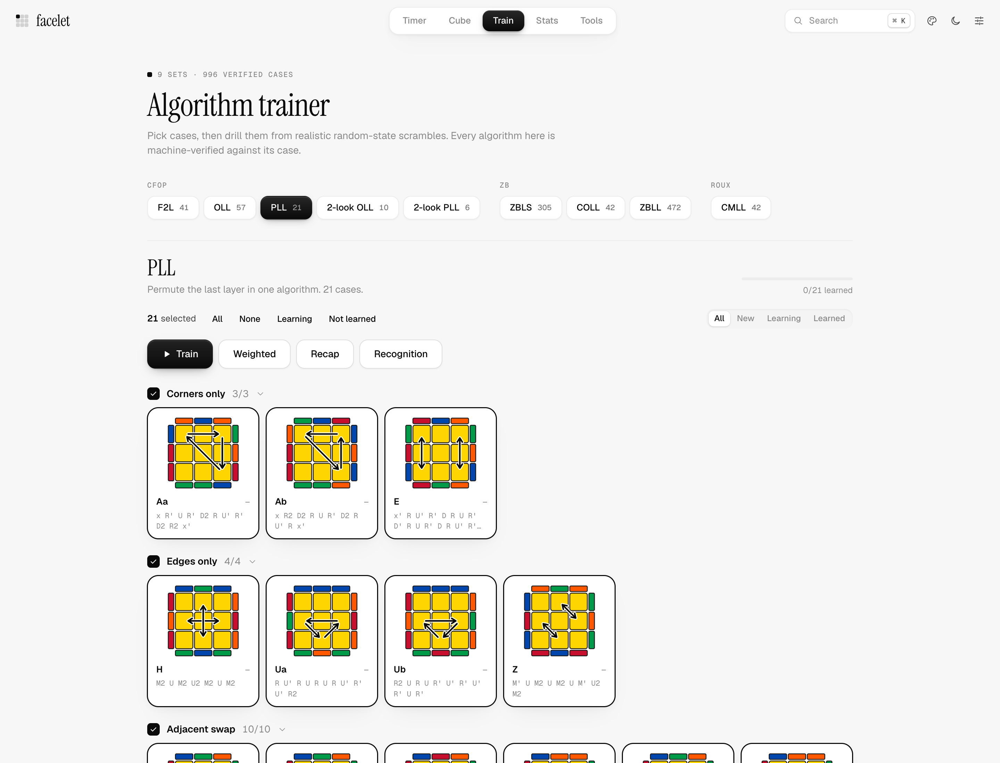
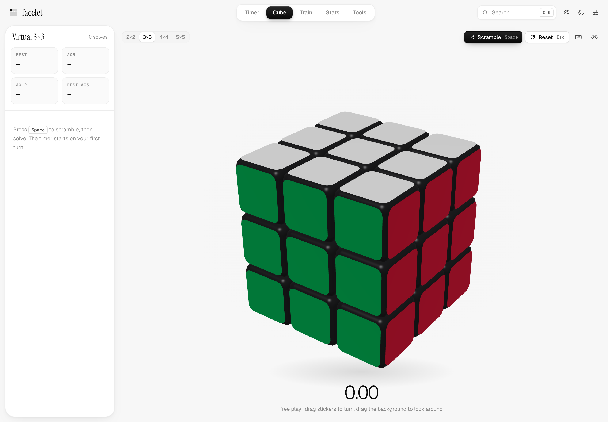
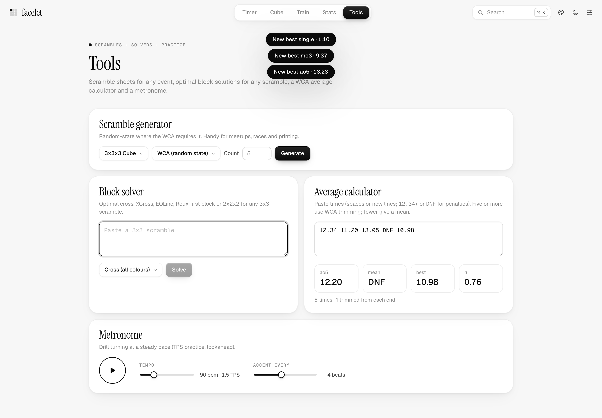

# Facelet

A quiet place to get faster at cubing.

Facelet brings a solve timer, session statistics, an algorithm trainer, and a virtual cube into one browser app. Open it, pick an event, and start practicing. Your solves stay on your device, with no account or backend to set up.



## Made for daily practice

- **Time your solves.** Hold Space, release to start, and press a key to stop. Use touch on a phone, or enter times manually. Add inspection, splits, penalties, and notes as needed.
- **See your progress.** Track rolling averages, personal bests, distributions, and practice streaks. Keep separate sessions for different events or routines.
- **Learn your next algorithm.** Browse 996 verified cases across CFOP, ZB, and Roux sets. Drill selected cases, revisit slower ones, or practice recognition. Add your own algorithms and check that they solve the case.
- **Practice without a physical cube.** Turn a WebGL cube with the keyboard or mouse. Choose 2×2 through 5×5, scramble it, and review timed solves with move counts and replays.
- **Make it feel right.** Choose light or dark mode, adjust palettes and timer fonts, and arrange the timer layout around your practice.

Scrambles cover 2×2–7×7, one-handed and blindfolded events, FMC, Clock, Megaminx, Pyraminx, Skewb, and Square-1. Built-in tools include cross and block solvers, a batch scramble generator, an average calculator, and a metronome.

## A look around

<details>
<summary>Timer in dark mode</summary>



</details>

### Statistics

See how a session is changing, beyond the latest single. Rolling averages sit alongside a time distribution, personal-best history, and a practice calendar.



### Algorithm trainer

Open a case and choose **Learn in 3D** to step through its algorithm or try an alternative. When you’re ready, practice that case from a fresh scramble. Learning status and per-case times help you decide what to work on next.



### Virtual cube

A keyboard- and mouse-controlled cube, with familiar csTimer key bindings and automatic solve timing.



### Tools

Work through a cross, generate a sheet of scrambles, or check an average without leaving the app.



*Screenshots are captured from the running app at 2× resolution. The timer and statistics use illustrative practice data.*

## Run locally

Use **Node.js 22.12 or newer** and npm.

```bash
git clone https://github.com/jamesliuai/facelet.git
cd facelet
npm ci
npm run dev
```

Open the local URL printed by Vite, usually `http://localhost:5173`.

| Command | Purpose |
| --- | --- |
| `npm run dev` | Start the development server |
| `npm run check` | Check Svelte and TypeScript |
| `npm test` | Run the test suite |
| `npm run build` | Build the static site into `dist/` |
| `npm run preview` | Preview the production build locally |
| `npm run verify:algs` | Verify the trainer algorithms |
| `npm run import:algs -- <path to alg_list.js>` | Refresh the community algorithms from the credited source |

To host your own copy, run `npm run build` and deploy `dist/` to a static host over HTTPS. Relative asset paths and hash-based navigation support hosting under a subdirectory. The production build includes a service worker for offline use after the app has been loaded.

## Your data

Solve history and trainer data are stored in IndexedDB; preferences are stored in localStorage. There are no accounts, analytics, or cloud sync. Data belongs to the browser and site address you use, so export a backup before switching devices, changing hosts, or clearing browser storage.

Facelet can import csTimer exports and restore its own JSON backups. You can also export individual sessions as CSV.

## Development

Built with **Svelte 5, TypeScript, and Vite**. Scramble generation runs in a Web Worker, and the virtual cube uses WebGL2. Fonts are bundled locally.

```text
src/pages/          Timer, cube, trainer, statistics, tools, and settings
src/components/     Shared controls, dialogs, and charts
src/lib/cube/       Cube models, notation, and two-phase solver
src/lib/puzzles/    Event-specific puzzle models and solvers
src/lib/scramble/   Scramble generators and worker
src/lib/timer/      Timer state machine and inspection audio
src/lib/stats/      Averages, formatting, and statistics engine
src/lib/trainer/    Case sets, setup scrambles, and practice state
src/lib/vcube/      WebGL renderer and virtual-cube controls
src/lib/store/      Browser persistence and settings
src/lib/io/         Backup, restore, CSV, and csTimer import
scripts/            Algorithm generation and asset utilities
tests/              Solver, scramble, timer, statistics, and algorithm tests
```

Before submitting a change, run `npm run check`, `npm test`, and `npm run build`. GitHub Actions runs the same checks on pushes and pull requests. For interface changes, also check the relevant flow at desktop and phone widths.

Bluetooth smart cubes, hardware timers, and microphone-based Stackmat input are not currently supported. See [the development audit](AUDIT.md) for implementation notes and known rough edges.

## Credits

Facelet uses Svelte and Vite, with Geist and Geist Mono by Vercel and Instrument Serif by the Instrument Serif project. The bundled fonts include their [SIL Open Font License notices](src/assets/fonts/).

The F2L, COLL, CMLL, ZBLL, and ZBLS algorithms are sourced from [Tao Yu’s Alg Trainer](https://github.com/tao-yu/Alg-Trainer/blob/cb95945c3e4839ee1e4b058d4a79bc022615b220/js/alg_list.js) ([MIT license](public/licenses/tao-yu-alg-trainer.txt)). The case dialog links to the source of each sequence, including ZBLL collections by Juliette Sébastien and by Jabari Nuruddin, Justin Taylor, and Tao Yu, and the ZBLS collection by Chad Batten and Tao Yu. Facelet matches sequences by cube state and adjusts the starting turn or viewing angle where needed. To refresh the library, pass the pinned `alg_list.js` file to `npm run import:algs` and run `npm run verify:algs`.
